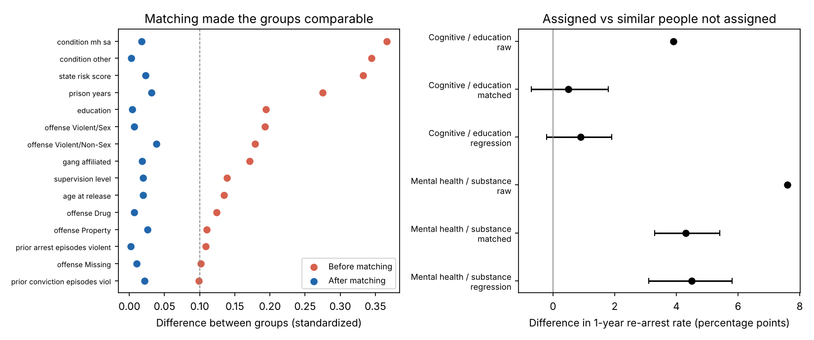
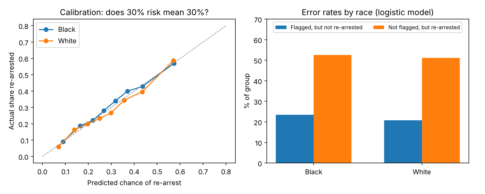

# Does a Supervision Program Reduce Re-Arrests?

Two questions about people released to parole, using the National Institute of Justice's public
**Recidivism Forecasting Challenge** data (25,835 people released in Georgia, 2013–2015):

1. **Program effect:** were people assigned cognitive-skills / education programming re-arrested less in their
   first year than *similar* people who were not?
2. **Prediction and fairness:** how well can we predict first-year re-arrest, and does the model make more
   mistakes for some groups than others?

📄 **[Read the 4-page white paper (PDF)](reports/white_paper.pdf)**, written for a policy audience.

## Key findings

**1. No detectable effect of the program on first-year re-arrest.**

| | Assigned | Comparison | Difference | 95% CI |
|---|---:|---:|---:|---|
| Raw comparison | 32.0% | 28.2% | +3.9 pts | |
| **Propensity-score matched** (11,440 pairs) | 32.0% | 31.5% | **+0.5 pts** | −0.7 to +1.8 |
| Regression adjustment (check) | | | +0.9 pts | −0.2 to +1.9 |

The raw gap is almost entirely selection: officers assign the program to people with longer prison terms
and higher risk scores. Matching on 63 facts known at release cut the largest group difference from 0.37 to
0.04 standard deviations, and the gap in re-arrest disappeared.

The same method applied to mental health / substance abuse programming still shows +4.3 pts (3.3 to 5.4)
after matching. That is very likely **unmeasured need** (or closer supervision), not harm, and it shows the
limit of matching: it can only balance what is recorded.



**2. A simple model predicts about as well as a complex one, and beats the state's risk score.**

| Model (tested on NIJ's 7,807-person held-out set) | AUC (95% CI) | Brier |
|---|---|---|
| State risk score alone | 0.585 (0.572–0.599) | |
| **Logistic regression** | **0.699** (0.686–0.710) | 0.189 |
| XGBoost | 0.706 (0.693–0.718) | 0.187 |

**3. Fair across race on calibration, but a single cut-off misses most women at risk.**

| Group | Flagged, but not re-arrested | Re-arrested, but not flagged |
|---|---:|---:|
| Black | 23.5% | 52.5% |
| White | 20.8% | 51.1% |
| Men | 24.9% | 49.0% |
| Women | 5.8% | **81.7%** |



## Method notes

- **No leakage:** only information known *at release* is used. The data's supervision-period measures (drug
  tests, violations, program attendance, employment) are excluded, because they are recorded during the
  outcome window.
- **Race and sex are not model inputs.** They are used only to audit errors (and, in the program analysis, to
  make the matched groups comparable).
- **Matching:** 1-to-1 nearest neighbour on the logit of the propensity score, with replacement, caliper
  0.2 SD; balance checked with standardized mean differences; 95% CIs from 1,000 bootstrap resamples.
- **Prediction:** NIJ's official train/test split; AUC CIs by bootstrap; fairness checked at a cut-off that
  flags the same share (30%) as were actually re-arrested.

## Outputs

| File | What it is |
|---|---|
| `reports/white_paper.pdf` | 4-page white paper for non-technical readers |
| `reports/dashboard.html` | interactive dashboard: download and open in a browser |
| `reports/for_bi/` | tidy CSV tables ready for Power BI or Tableau |
| `reports/*.json`, `*.csv` | every number in the README and white paper |

## Run it

```bash
pip install -r requirements.txt
bash run_all.sh      # about 1 minute; each step prints progress
```

| Step | Script | Time |
|---|---|---|
| 1 | `src/predict_and_audit.py`: models, AUC, fairness audit | ~10 s |
| 2 | `src/program_effect.py`: matching, balance, bootstrap CIs (prints every 250 resamples) | ~45 s |
| 3 | `src/build_report.py`: dashboard and white paper PDF | ~5 s |

## Data

National Institute of Justice, *Recidivism Forecasting Challenge* full dataset (public release,
[data.ojp.usdoj.gov](https://data.ojp.usdoj.gov/Courts/NIJ-s-Recidivism-Challenge-Full-Dataset/ynf5-u8nk)).
A compressed copy is included in `data/raw/`.

## Limitations

Re-arrest reflects policing as well as behavior. The program variable records *assignment*, not completion.
Results are from Georgia in 2013–2015 and may not carry over elsewhere.
