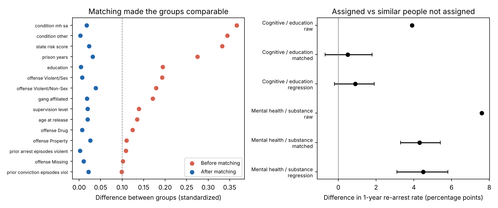
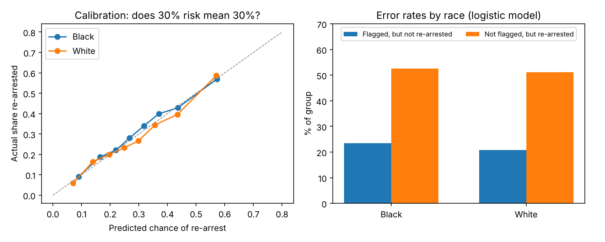

## Summary for decision-makers

- **People assigned to cognitive-skills or education programming were re-arrested at about the same rate as
  similar people who were not assigned.** A raw comparison makes the program look harmful (+3.9 percentage
  points), but that gap is almost entirely explained by *who* gets assigned. After comparing like with like,
  the difference is **+0.5 points (95% CI: −0.7 to +1.8)**, too small to tell apart from zero.
- **A simple, explainable model predicts one-year re-arrest about as well as a complex one** (AUC 0.70 vs 0.71),
  and both rank people much better than the state's existing risk score alone (AUC 0.59).
- **The model's mistakes are similar across racial groups but very different by sex.** Its risk estimates are
  equally accurate for Black and White people. But women are rarely flagged, so 82% of women who were
  re-arrested were missed, compared with 49% of men.
- **Recommendation:** treat program assignment as something to *evaluate*, not assume works. A randomized pilot
  or a staggered rollout would give a much clearer answer than historical records can.

## 1. The question

Parole officers in Georgia can require people under supervision to attend programs. One common condition
requires **cognitive-skills or education programming** (for example, cognitive behavioral courses, GED
classes). This paper asks two questions agencies care about:

1. Were people given this condition re-arrested less in their first year after release?
2. Can we predict who is most at risk of re-arrest, accurately *and* fairly?

## 2. The data

The National Institute of Justice (NIJ) released this dataset for its 2021 Recidivism Forecasting Challenge.
It covers **25,835 people** released from Georgia prisons to parole supervision between 2013 and 2015. For
each person it records demographics, prison and criminal history, supervision conditions, and whether they
were re-arrested within one, two, and three years. **29.9%** were re-arrested within the first year.

**An important design choice:** the data also include things measured *during* supervision (drug tests,
violations, program attendance, employment). We did not use them. They are recorded over the same period as
the outcome, and someone re-arrested in month two has had little time to attend programs or hold a job.
Using them would make both the predictions and the program comparison look better than they really are.

## 3. Did the program reduce re-arrests?

**The challenge.** Programs are not assigned at random. Officers give them to people with more needs:
people assigned the cognitive/education condition had longer prison terms, higher state risk scores, and
lower education. Comparing them directly with everyone else mixes the program's effect with these
differences.

**The method.** We used **propensity score matching**. For every person, we estimated the chance they would be
assigned the condition, based on 63 facts known at release. Then we paired each assigned person with the
unassigned person whose chance was closest. Within these pairs the two groups look alike on everything we
measured: the largest standardized difference fell from **0.37 to 0.04** (below 0.1 is the usual standard
for "well balanced"). We then compared re-arrest rates within the pairs. We checked the result with a second,
independent method (regression adjustment), and computed 95% confidence intervals from 1,000 bootstrap
resamples.

| | Assigned | Comparison | Difference (pts) | 95% CI |
|---|---:|---:|---:|---|
| Raw comparison (everyone) | 32.0% | 28.2% | +3.9 | |
| **Matched comparison** (11,440 pairs) | 32.0% | 31.5% | **+0.5** | −0.7 to +1.8 |
| Regression adjustment | | | +0.9 | −0.2 to +1.9 |

**What this means.** After accounting for who was assigned, there is **no detectable difference** in
first-year re-arrest. That is not proof the program does nothing. It may help with outcomes not measured
here (employment, longer-term re-arrest), or work well for some people and not others. But the records give
no sign of a reduction in first-year re-arrests.

**A warning sign from the comparison condition.** We ran the same analysis for **mental health / substance
abuse** programming. There, assigned people were still **4.3 points more likely** to be re-arrested after
matching (95% CI: 3.3 to 5.4). It is very unlikely that treatment itself causes re-arrest. A more plausible
explanation is that this condition is assigned for needs the dataset doesn't record (such as active addiction),
or that these people are watched more closely, so offenses are more likely to be detected. This is exactly
the limit of matching: **it can only balance what was measured.** It is also why a randomized evaluation is
worth the effort.

## 4. Predicting re-arrest within one year

We trained models on NIJ's official training split (18,028 people) and tested them on the 7,807 people held
out. **Race and sex were not used as inputs.**

| Model | AUC (95% CI) | Brier score |
|---|---|---|
| State risk score alone | 0.585 (0.572–0.599) | |
| **Logistic regression** | **0.699** (0.686–0.710) | 0.189 |
| XGBoost | 0.706 (0.693–0.718) | 0.187 |
| Guessing the average for everyone | 0.500 | 0.210 |

*AUC: how often the model ranks a person who was re-arrested above one who was not (0.5 = coin flip,
1.0 = perfect). Brier score: average squared error of the predicted probabilities (lower is better).*

The flexible model adds only 0.007 AUC, and the confidence intervals overlap. For a public agency, the
logistic model is the better choice: each input has one readable weight, and it can be explained to the
people it scores. The strongest factors were **age at release** (younger people had higher risk), **gang
affiliation**, and **number of prior felony and property arrests**.

## 5. Is the model fair?

We flagged as "high risk" the 30% of people with the highest predicted risk (the same share as were actually
re-arrested), and compared errors across groups.

| Group | People | Actually re-arrested | Flagged, but not re-arrested | Re-arrested, but not flagged |
|---|---:|---:|---:|---:|
| Black | 4,534 | 31.5% | 23.5% | 52.5% |
| White | 3,273 | 28.1% | 20.8% | 51.1% |
| Men | 6,857 | 31.2% | 24.9% | 49.0% |
| Women | 950 | 21.9% | 5.8% | 81.7% |

- **By race:** risk estimates are well calibrated for both groups (a 30% prediction means about 30% in both).
  Black people who were *not* re-arrested were flagged somewhat more often (23.5% vs 20.8%), largely because
  the measured risk factors (such as prior arrests) differ between groups. Prior arrests can themselves reflect
  differences in policing, so this gap should be monitored, not ignored.
- **By sex:** a single cut-off works poorly for women. Because women's re-arrest rate is lower, very few are
  flagged, and most women who were re-arrested were missed. If a tool like this guided services, women would
  likely be under-served. A separate cut-off or a model built for women would be worth testing.

## 6. Limitations

- Re-arrest is not the same as re-offending: it depends on police activity as well as behavior.
- Georgia, 2013–2015: results may not carry over to other places or years, including the District.
- Matching balances only the 63 factors in the data. Unmeasured needs can still bias the program comparison.
- The program variable records *assignment*, not attendance or completion.

## 7. Recommendations

1. **Evaluate programs prospectively.** A randomized or staggered rollout of program conditions would answer
   the effectiveness question far more reliably than historical records.
2. **Prefer explainable risk models.** The simple model performs about as well as the complex one.
3. **Audit every risk tool by group before use,** and repeat the audit regularly. Check calibration *and*
   error rates, not just overall accuracy.
4. **Do not apply one cut-off to everyone without checking subgroups.** Here it would miss most women at risk.

---
*Code, data and every number in this paper are reproducible from the project repository (`bash run_all.sh`).
Data: National Institute of Justice, "Recidivism Forecasting Challenge" (2021), public release.*
